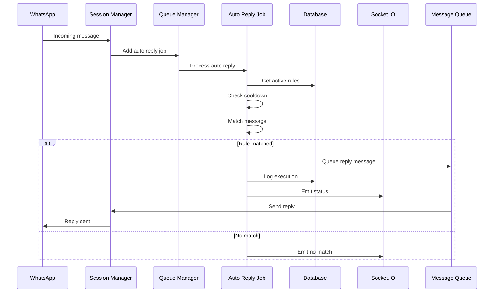

# Auto Reply Engine Design

## Overview

Auto Reply Engine adalah sistem otomatis untuk membalas pesan WhatsApp berdasarkan aturan yang telah dikonfigurasi. Sistem ini mendukung berbagai jenis trigger dan response dengan fitur-fitur canggih seperti cooldown, time restrictions, dan AI integration.

## Architecture

### Auto Reply Flow Pipeline



### Core Components

#### 1. Auto Reply Rules
- **Match Types**: exact, contains, starts_with, ends_with, regex
- **Reply Types**: text, image, video, document, audio
- **Conditions**: time restrictions, group settings, cooldown
- **Priority System**: Lower number = higher priority

#### 2. Message Processing
- **Real-time Processing**: Incoming messages processed immediately
- **Rule Matching**: Sequential matching based on priority
- **Variable Substitution**: Dynamic content with placeholders
- **Cooldown Management**: Prevent spam with Redis-based cooldown

#### 3. Logging & Analytics
- **Execution Logs**: Complete audit trail of auto reply executions
- **Performance Metrics**: Success rates, response times, trigger counts
- **Statistics Dashboard**: Real-time analytics and reporting

## Auto Reply Rule Structure

### Basic Rule Configuration
```javascript
{
  device_id: 123,
  user_id: 456,
  name: "Welcome Message",
  match_type: "contains",
  keywords: "hello,hi,halo,hai",
  reply_type: "text",
  reply_text: "Hello {name}! Welcome to our service.",
  is_active: true,
  priority: 1
}
```

### Advanced Rule Configuration
```javascript
{
  device_id: 123,
  user_id: 456,
  name: "Business Hours Auto Reply",
  match_type: "contains",
  keywords: "info,help,support",
  reply_type: "text",
  reply_text: "Thank you for contacting us. Our business hours are 9AM-5PM Monday-Friday.",
  is_active: true,
  priority: 2,
  cooldown_minutes: 60,
  max_daily_replies: 5,
  is_group_enabled: false,
  time_start: "09:00",
  time_end: "17:00",
  delay_seconds: 3,
  conditions: {
    exclude_numbers: ["628123456789"],
    include_keywords: ["urgent", "important"]
  },
  metadata: {
    category: "business_info",
    created_by: "admin"
  }
}
```

## Match Types

### 1. Exact Match
```javascript
{
  match_type: "exact",
  keywords: "hello,hi,help"
}
// Matches: "hello", "hi", "help"
// Doesn't match: "hello there", "helping"
```

### 2. Contains Match
```javascript
{
  match_type: "contains",
  keywords: "price,cost,berapa"
}
// Matches: "what's the price?", "how much does it cost?", "berapa harganya?"
```

### 3. Starts With Match
```javascript
{
  match_type: "starts_with",
  keywords: "order,pesan,beli"
}
// Matches: "order now", "pesan sekarang", "beli produk"
```

### 4. Ends With Match
```javascript
{
  match_type: "ends_with",
  keywords: "?,.com,thanks"
}
// Matches: "how are you?", "visit website.com", "thanks"
```

### 5. Regex Match
```javascript
{
  match_type: "regex",
  keywords: "\\b\\d{4}\\b"
}
// Matches: messages containing 4-digit numbers
```

## Reply Types

### 1. Text Reply
```javascript
{
  reply_type: "text",
  reply_text: "Hello {name}! Your message: {message}"
}
```

### 2. Image Reply
```javascript
{
  reply_type: "image",
  reply_media_url: "https://example.com/image.jpg",
  reply_text: "Check out our latest product!"
}
```

### 3. Video Reply
```javascript
{
  reply_type: "video",
  reply_media_url: "https://example.com/video.mp4",
  reply_text: "Watch our tutorial video"
}
```

### 4. Document Reply
```javascript
{
  reply_type: "document",
  reply_media_url: "https://example.com/brochure.pdf",
  reply_text: "Product Brochure"
}
```

### 5. Audio Reply
```javascript
{
  reply_type: "audio",
  reply_media_url: "https://example.com/voice.mp3"
}
```

## Variable Substitution

### Available Variables
```javascript
const variables = {
  '{name}': incomingMessage.pushName || incomingMessage.from_number,
  '{number}': incomingMessage.from_number,
  '{message}': incomingMessage.content,
  '{time}': new Date().toLocaleTimeString(),
  '{date}': new Date().toLocaleDateString(),
  '{datetime}': new Date().toLocaleString()
};
```

### Usage Examples
```javascript
// Template
"Hello {name}! You sent: {message} at {time}"

// Result
"Hello John Doe! You sent: Hello there at 10:30:45 AM"
```

## Advanced Features

### 1. Cooldown System
```javascript
{
  cooldown_minutes: 60 // Wait 60 minutes before replying again to same number
}
```

**Implementation:**
- Redis-based cooldown tracking
- Per-number, per-rule cooldown
- Automatic cleanup of expired cooldowns

### 2. Daily Limits
```javascript
{
  max_daily_replies: 5 // Maximum 5 replies per day per number
}
```

### 3. Time Restrictions
```javascript
{
  time_start: "09:00",
  time_end: "17:00" // Only reply during business hours
}
```

**Supports:**
- Same-day ranges (09:00 - 17:00)
- Overnight ranges (22:00 - 06:00)
- Timezone-aware processing

### 4. Group Chat Control
```javascript
{
  is_group_enabled: false // Don't reply in group chats
}
```

### 5. Priority System
```javascript
// Higher priority (processed first)
{ priority: 1, keywords: "urgent,emergency" }

// Lower priority (processed later)
{ priority: 5, keywords: "info,general" }
```

### 6. Delay Control
```javascript
{
  delay_seconds: 3 // Wait 3 seconds before sending reply
}
```

## Rule Processing Logic

### 1. Rule Matching Algorithm
```javascript
const processAutoReply = async (deviceId, incomingMessage) => {
  // 1. Get active rules (ordered by priority)
  const rules = await getActiveRules(deviceId);
  
  // 2. Check cooldown
  const cooldownCheck = await checkCooldown(deviceId, fromNumber);
  if (!cooldownCheck.allowed) return;
  
  // 3. Find first matching rule
  for (const rule of rules) {
    if (await isRuleMatched(rule, messageContent, incomingMessage)) {
      // 4. Send auto reply
      await sendAutoReply(deviceId, fromNumber, rule, incomingMessage);
      
      // 5. Set cooldown
      await setCooldown(deviceId, fromNumber, rule.cooldown_minutes);
      
      // 6. Log execution
      await logAutoReply(deviceId, rule.id, incomingMessage, result);
      
      break; // Stop at first match
    }
  }
};
```

### 2. Message Matching
```javascript
const isRuleMatched = (rule, messageContent, incomingMessage) => {
  // Check group settings
  if (incomingMessage.is_group && !rule.is_group_enabled) {
    return false;
  }
  
  // Check time restrictions
  if (!isWithinTimeRestrictions(rule)) {
    return false;
  }
  
  // Check daily limits
  if (!checkDailyLimits(rule, incomingMessage.from_number)) {
    return false;
  }
  
  // Match keywords based on match_type
  return matchKeywords(rule.match_type, rule.keywords, messageContent);
};
```

### 3. Reply Generation
```javascript
const generateReply = (rule, incomingMessage) => {
  let replyText = rule.reply_text;
  
  // Replace variables
  const variables = {
    '{name}': incomingMessage.pushName || incomingMessage.from_number,
    '{number}': incomingMessage.from_number,
    '{message}': incomingMessage.content,
    '{time}': new Date().toLocaleTimeString(),
    '{date}': new Date().toLocaleDateString(),
    '{datetime}': new Date().toLocaleString()
  };
  
  for (const [variable, value] of Object.entries(variables)) {
    replyText = replyText.replace(new RegExp(variable, 'g'), value);
  }
  
  return {
    type: rule.reply_type,
    text: replyText,
    media_url: rule.reply_media_url
  };
};
```

## Predefined Templates

### 1. Welcome Message Template
```javascript
{
  id: 'welcome',
  name: 'Welcome Message',
  match_type: 'contains',
  keywords: 'hello,hi,halo,hai',
  reply_type: 'text',
  reply_text: 'Hello {name}! Welcome to our service. How can I help you today?',
  category: 'greeting'
}
```

### 2. Business Hours Template
```javascript
{
  id: 'business_hours',
  name: 'Business Hours Info',
  match_type: 'contains',
  keywords: 'hours,open,close,time',
  reply_type: 'text',
  reply_text: 'Our business hours are Monday-Friday 9AM-5PM. We will respond during business hours.',
  time_start: '09:00',
  time_end: '17:00',
  category: 'information'
}
```

### 3. Away Message Template
```javascript
{
  id: 'away_message',
  name: 'Away Message',
  match_type: 'contains',
  keywords: '*', // Match all messages
  reply_type: 'text',
  reply_text: 'Thank you for your message. I am currently away and will respond as soon as possible.',
  priority: 10, // Low priority (catch-all)
  category: 'status'
}
```

### 4. Price Inquiry Template
```javascript
{
  id: 'price_inquiry',
  name: 'Price Inquiry',
  match_type: 'contains',
  keywords: 'price,cost,how much,berapa',
  reply_type: 'text',
  reply_text: 'Thank you for your interest! Please visit our website or contact our sales team for pricing information.',
  category: 'sales'
}
```

### 5. Support Ticket Template
```javascript
{
  id: 'support_ticket',
  name: 'Support Ticket',
  match_type: 'contains',
  keywords: 'help,support,problem,issue',
  reply_type: 'text',
  reply_text: 'I understand you need help. Your support ticket #{datetime} has been created. Our team will assist you shortly.',
  category: 'support'
}
```

## Real-time Events

### Socket.IO Auto Reply Events
```javascript
// Auto reply rule created
socket.emit('auto_reply:created', {
  autoReply: { /* rule data */ },
  timestamp: new Date()
});

// Auto reply rule updated
socket.emit('auto_reply:updated', {
  autoReply: { /* updated rule data */ },
  timestamp: new Date()
});

// Auto reply rule deleted
socket.emit('auto_reply:deleted', {
  autoReplyId: 123,
  timestamp: new Date()
});

// Auto reply status changed
socket.emit('auto_reply:status_changed', {
  autoReply: { /* rule data with new status */ },
  timestamp: new Date()
});

// Auto reply executed
socket.emit('auto_reply:executed', {
  ruleId: 123,
  ruleName: 'Welcome Message',
  fromNumber: '628123456789',
  triggerMessage: 'hello',
  replyType: 'text',
  success: true,
  timestamp: new Date()
});

// Auto reply failed
socket.emit('auto_reply:failed', {
  ruleId: 123,
  ruleName: 'Welcome Message',
  fromNumber: '628123456789',
  error: 'Rate limit exceeded',
  timestamp: new Date()
});
```

## API Endpoints

### Core Auto Reply Management
- `POST /api/v1/auto-replies` - Create auto reply rule
- `GET /api/v1/auto-replies` - Get auto reply rules with filtering
- `GET /api/v1/auto-replies/:id` - Get specific auto reply rule
- `PUT /api/v1/auto-replies/:id` - Update auto reply rule
- `DELETE /api/v1/auto-replies/:id` - Delete auto reply rule

### Rule Management
- `POST /api/v1/auto-replies/:id/toggle` - Toggle rule status
- `PUT /api/v1/auto-replies/priorities` - Update rule priorities
- `POST /api/v1/auto-replies/:id/duplicate` - Duplicate rule
- `POST /api/v1/auto-replies/:id/test` - Test rule with sample message

### Templates & Presets
- `GET /api/v1/auto-replies/templates` - Get predefined templates
- `POST /api/v1/auto-replies/from-template` - Create rule from template

### Analytics & Logs
- `GET /api/v1/auto-replies/statistics/:deviceId` - Get auto reply statistics
- `GET /api/v1/auto-replies/logs` - Get execution logs

### Import/Export
- `GET /api/v1/auto-replies/export/:deviceId` - Export rules (JSON/CSV)
- `POST /api/v1/auto-replies/import/:deviceId` - Import rules

## Database Schema

### Auto Replies Table
```sql
CREATE TABLE auto_replies (
  id INT PRIMARY KEY AUTO_INCREMENT,
  device_id INT NOT NULL,
  user_id INT NOT NULL,
  name VARCHAR(255) NOT NULL,
  match_type ENUM('exact', 'contains', 'starts_with', 'ends_with', 'regex') NOT NULL,
  keywords TEXT NOT NULL,
  reply_type ENUM('text', 'image', 'video', 'document', 'audio') NOT NULL,
  reply_text TEXT,
  reply_media_url VARCHAR(500),
  reply_media_type ENUM('image', 'video', 'document', 'audio'),
  is_active BOOLEAN DEFAULT TRUE,
  priority INT DEFAULT 1,
  cooldown_minutes INT DEFAULT 0,
  max_daily_replies INT DEFAULT 0,
  is_group_enabled BOOLEAN DEFAULT FALSE,
  time_start TIME,
  time_end TIME,
  delay_seconds INT DEFAULT 0,
  conditions JSON,
  metadata JSON,
  created_at TIMESTAMP DEFAULT CURRENT_TIMESTAMP,
  updated_at TIMESTAMP DEFAULT CURRENT_TIMESTAMP ON UPDATE CURRENT_TIMESTAMP,
  
  FOREIGN KEY (device_id) REFERENCES devices(id) ON DELETE CASCADE,
  FOREIGN KEY (user_id) REFERENCES users(id) ON DELETE CASCADE,
  
  INDEX idx_device_active (device_id, is_active),
  INDEX idx_priority (priority),
  INDEX idx_match_type (match_type)
);
```

### Auto Reply Logs Table
```sql
CREATE TABLE auto_reply_logs (
  id INT PRIMARY KEY AUTO_INCREMENT,
  auto_reply_id INT NOT NULL,
  device_id INT NOT NULL,
  trigger_message_id INT,
  from_number VARCHAR(20) NOT NULL,
  trigger_text TEXT NOT NULL,
  reply_sent BOOLEAN DEFAULT FALSE,
  reply_job_id VARCHAR(100),
  cooldown_active BOOLEAN DEFAULT FALSE,
  daily_limit_reached BOOLEAN DEFAULT FALSE,
  error_message TEXT,
  executed_at TIMESTAMP DEFAULT CURRENT_TIMESTAMP,
  
  FOREIGN KEY (auto_reply_id) REFERENCES auto_replies(id) ON DELETE CASCADE,
  FOREIGN KEY (device_id) REFERENCES devices(id) ON DELETE CASCADE,
  FOREIGN KEY (trigger_message_id) REFERENCES messages(id) ON DELETE SET NULL,
  
  INDEX idx_auto_reply_id (auto_reply_id),
  INDEX idx_device_date (device_id, executed_at),
  INDEX idx_from_number (from_number)
);
```

## Performance Optimizations

### 1. Rule Caching
```javascript
// Cache active rules per device
const cacheKey = `auto_rules:${deviceId}`;
const cachedRules = await redis.get(cacheKey);

if (!cachedRules) {
  const rules = await autoReplyRepository.getActiveByDeviceId(deviceId);
  await redis.setex(cacheKey, 300, JSON.stringify(rules)); // 5 minutes cache
}
```

### 2. Cooldown Optimization
```javascript
// Use Redis for fast cooldown checks
const cooldownKey = `cooldown:${deviceId}:${fromNumber}`;
const cooldownUntil = await redis.get(cooldownKey);

if (cooldownUntil && new Date() < new Date(cooldownUntil)) {
  return { allowed: false, cooldownUntil: new Date(cooldownUntil) };
}
```

### 3. Batch Processing
```javascript
// Process multiple incoming messages in batches
const processBatch = async (messages) => {
  const promises = messages.map(message => 
    processAutoReply(message.deviceId, message)
  );
  
  await Promise.all(promises);
};
```

### 4. Database Indexing
- Composite indexes for common queries
- Partial indexes for active rules only
- Time-based partitioning for logs

## Error Handling

### 1. Rule Validation Errors
```javascript
const validateRule = (ruleData) => {
  const errors = [];
  
  if (!ruleData.name) errors.push('Name is required');
  if (!ruleData.keywords) errors.push('Keywords are required');
  if (ruleData.match_type === 'regex') {
    try {
      new RegExp(ruleData.keywords);
    } catch (e) {
      errors.push('Invalid regex pattern');
    }
  }
  
  return { isValid: errors.length === 0, errors };
};
```

### 2. Processing Errors
```javascript
const processAutoReplyWithErrorHandling = async (data) => {
  try {
    return await processAutoReply(data);
  } catch (error) {
    logger.error('Auto reply processing failed:', error);
    
    // Log error for debugging
    await logAutoReplyError(data.deviceId, data.incomingMessage, error);
    
    // Emit error event
    socketManager.emitToDevice(data.deviceId, 'auto_reply:error', {
      error: error.message,
      timestamp: new Date()
    });
    
    // Don't throw - continue processing other messages
    return { success: false, error: error.message };
  }
};
```

### 3. Rate Limiting
```javascript
const checkRateLimit = async (deviceId) => {
  const rateLimitKey = `rate_limit:auto_reply:${deviceId}`;
  const current = await redis.incr(rateLimitKey);
  
  if (current === 1) {
    await redis.expire(rateLimitKey, 60); // 1 minute window
  }
  
  if (current > 100) { // Max 100 auto replies per minute
    throw new Error('Auto reply rate limit exceeded');
  }
};
```

## Security Considerations

### 1. Input Sanitization
```javascript
const sanitizeInput = (input) => {
  // Remove potentially dangerous characters
  return input.replace(/[<>\"'&]/g, '');
};

const sanitizeReplyText = (text) => {
  // Prevent injection attacks in reply text
  return text.replace(/\{[^}]*\}/g, (match) => {
    const allowedVariables = ['name', 'number', 'message', 'time', 'date', 'datetime'];
    const variable = match.slice(1, -1);
    return allowedVariables.includes(variable) ? match : '';
  });
};
```

### 2. Access Control
```javascript
const validateRuleAccess = async (userId, ruleId) => {
  const rule = await autoReplyRepository.findById(ruleId);
  if (!rule || rule.user_id !== userId) {
    throw new Error('Access denied');
  }
  return rule;
};
```

### 3. Content Filtering
```javascript
const filterContent = (content) => {
  // Check for spam patterns
  const spamPatterns = [
    /(.)\1{10,}/, // Repeated characters
    /https?:\/\/[^\s]+/gi, // URLs (optional filtering)
    /\b\d{4}\s?\d{4}\s?\d{4}\s?\d{4}\b/ // Credit card patterns
  ];
  
  return spamPatterns.some(pattern => pattern.test(content));
};
```

## Monitoring & Analytics

### 1. Performance Metrics
```javascript
const metrics = {
  totalRules: await autoReplyRepository.count(),
  activeRules: await autoReplyRepository.count({ is_active: true }),
  totalExecutions: await autoReplyLogRepository.count(),
  successRate: await calculateSuccessRate(),
  avgResponseTime: await calculateAvgResponseTime(),
  topTriggeredRules: await getMostTriggeredRules()
};
```

### 2. Health Checks
```javascript
const healthCheck = async () => {
  const checks = {
    database: await checkDatabaseConnection(),
    redis: await checkRedisConnection(),
    queueManager: await checkQueueHealth(),
    ruleProcessing: await testRuleProcessing()
  };
  
  return {
    status: Object.values(checks).every(check => check.healthy) ? 'healthy' : 'unhealthy',
    checks: checks,
    timestamp: new Date()
  };
};
```

### 3. Alerting
```javascript
const checkAlerts = async () => {
  const failureRate = await calculateFailureRate('1h');
  if (failureRate > 0.1) { // 10% failure rate
    await sendAlert('High auto reply failure rate', { rate: failureRate });
  }
  
  const queueDepth = await getQueueDepth('auto_reply');
  if (queueDepth > 1000) {
    await sendAlert('Auto reply queue backlog', { depth: queueDepth });
  }
};
```

## Integration Points

### 1. Session Manager Integration
```javascript
// Listen for incoming messages
SessionManager.on('message:received', async (deviceId, message) => {
  if (message.direction === 'incoming') {
    await autoReplyService.processIncomingMessage(deviceId, message);
  }
});
```

### 2. Message Queue Integration
```javascript
// Auto reply jobs use the same message queue
const sendAutoReply = async (deviceId, to, replyData) => {
  await queueManager.addMessageJob({
    type: 'send_message',
    deviceId: deviceId,
    to: to,
    messageType: replyData.type,
    content: replyData.content,
    priority: 10 // High priority for auto replies
  });
};
```

### 3. Webhook Integration
```javascript
// Trigger webhooks for auto reply events
const triggerWebhook = async (event, data) => {
  const webhookConfig = await getUserWebhookConfig(data.userId);
  
  if (webhookConfig && webhookConfig.auto_reply_events) {
    await queueManager.addWebhookJob({
      type: 'auto_reply_event',
      event: event,
      data: data,
      webhookUrl: webhookConfig.url,
      secret: webhookConfig.secret
    });
  }
};
```

---

## Implementation Checklist

- [x] AutoReplyRepository with full CRUD operations
- [x] AutoReplyService with business logic
- [x] AutoReplyController with REST API
- [x] Complete API routes with validation
- [x] Enhanced AutoReplyJob processing
- [x] Database schema updates
- [x] Real-time Socket.IO events
- [x] Predefined templates system
- [x] Rule testing functionality
- [x] Import/export capabilities
- [x] Statistics and analytics
- [x] Error handling and logging
- [x] Performance optimizations
- [x] Security measures
- [x] Swagger documentation

## Next Steps

The Auto Reply Engine is now complete and ready for integration with:
- **STEP 9**: Campaign/Blast System (can use auto reply templates)
- **STEP 10**: AI Integration (can enhance auto reply intelligence)
- **STEP 11**: REST API Documentation (auto reply endpoints included)
- **STEP 12**: Production deployment and monitoring

The system provides a solid foundation for automated customer service, lead qualification, and engagement automation through WhatsApp.