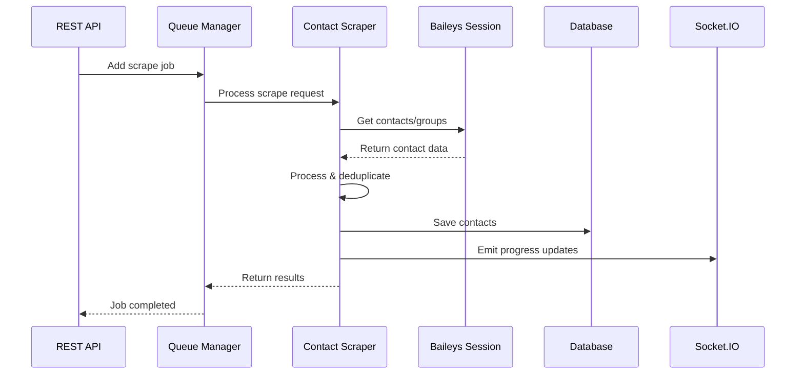

# Contact Scraping Flow Design

## Overview

Contact scraping system mengekstrak dan mengelola kontak dari berbagai sumber WhatsApp:

- **Private Chats** - Kontak dari percakapan pribadi
- **Group Members** - Anggota grup WhatsApp
- **Contact List** - Daftar kontak WhatsApp user
- **Broadcast Lists** - Anggota broadcast list

## Architecture

### Contact Scraping Flow



### Data Sources

1. **Private Chats**
   - Chat list dari Baileys
   - Extract contact info dari chat metadata
   - Status last seen, profile picture
   - Chat activity dan frequency

2. **Group Members**
   - Group list dari Baileys
   - Member list per group
   - Admin status dan permissions
   - Join date dan activity

3. **Contact List**
   - WhatsApp contact list
   - Saved contacts dengan nama
   - Phone numbers dan status
   - Profile information

4. **Broadcast Lists**
   - Broadcast list members
   - Recipient status
   - Delivery statistics

## Contact Processing Pipeline

### 1. Data Extraction
```javascript
// Extract contacts from different sources
const extractContacts = async (deviceId, sources) => {
  const results = {
    privateChats: [],
    groupMembers: [],
    contactList: [],
    broadcastLists: []
  };
  
  if (sources.includes('private_chats')) {
    results.privateChats = await extractPrivateChats(deviceId);
  }
  
  if (sources.includes('group_members')) {
    results.groupMembers = await extractGroupMembers(deviceId);
  }
  
  if (sources.includes('contact_list')) {
    results.contactList = await extractContactList(deviceId);
  }
  
  if (sources.includes('broadcast_lists')) {
    results.broadcastLists = await extractBroadcastLists(deviceId);
  }
  
  return results;
};
```

### 2. Data Normalization
```javascript
// Normalize contact data format
const normalizeContact = (rawContact, source) => {
  return {
    phone_number: extractPhoneNumber(rawContact.id),
    name: rawContact.name || rawContact.pushName || null,
    profile_picture: rawContact.profilePicture || null,
    status: rawContact.status || null,
    last_seen: rawContact.lastSeen || null,
    source: source,
    is_business: rawContact.isBusiness || false,
    business_info: rawContact.businessInfo || null,
    metadata: {
      original_id: rawContact.id,
      verified_name: rawContact.verifiedName,
      is_contact: rawContact.isContact,
      is_user: rawContact.isUser
    }
  };
};
```

### 3. Deduplication Logic
```javascript
// Advanced deduplication strategy
const deduplicateContacts = (contacts) => {
  const phoneMap = new Map();
  const duplicates = [];
  
  for (const contact of contacts) {
    const phone = normalizePhoneNumber(contact.phone_number);
    
    if (phoneMap.has(phone)) {
      const existing = phoneMap.get(phone);
      const merged = mergeContactData(existing, contact);
      phoneMap.set(phone, merged);
      duplicates.push({ existing, duplicate: contact, merged });
    } else {
      phoneMap.set(phone, contact);
    }
  }
  
  return {
    unique: Array.from(phoneMap.values()),
    duplicates: duplicates
  };
};
```

### 4. Contact Enrichment
```javascript
// Enrich contact data with additional info
const enrichContact = async (contact, deviceId) => {
  const enriched = { ...contact };
  
  // Get chat history stats
  const chatStats = await getChatStatistics(deviceId, contact.phone_number);
  enriched.chat_stats = chatStats;
  
  // Get group memberships
  const groupMemberships = await getGroupMemberships(deviceId, contact.phone_number);
  enriched.group_memberships = groupMemberships;
  
  // Get business info if available
  if (contact.is_business) {
    const businessInfo = await getBusinessInfo(deviceId, contact.phone_number);
    enriched.business_details = businessInfo;
  }
  
  // Calculate engagement score
  enriched.engagement_score = calculateEngagementScore(enriched);
  
  return enriched;
};
```

## Scraping Strategies

### 1. Full Scrape
- Scrape semua sumber kontak
- Proses lengkap dengan enrichment
- Untuk setup awal atau refresh complete

### 2. Incremental Scrape
- Hanya scrape kontak baru atau updated
- Berdasarkan timestamp terakhir scrape
- Untuk maintenance rutin

### 3. Targeted Scrape
- Scrape grup atau chat tertentu
- Filter berdasarkan kriteria
- Untuk campaign targeting

### 4. Scheduled Scrape
- Scrape otomatis berdasarkan jadwal
- Cron job untuk update berkala
- Maintenance data quality

## Contact Categories

### 1. Contact Types
```javascript
const CONTACT_TYPES = {
  PRIVATE: 'private',           // Kontak pribadi
  GROUP_MEMBER: 'group_member', // Anggota grup
  BUSINESS: 'business',         // Akun bisnis
  BROADCAST: 'broadcast',       // Broadcast list member
  UNKNOWN: 'unknown'            // Tidak diketahui
};
```

### 2. Contact Status
```javascript
const CONTACT_STATUS = {
  ACTIVE: 'active',           // Aktif di WhatsApp
  INACTIVE: 'inactive',       // Tidak aktif
  BLOCKED: 'blocked',         // Diblokir
  DELETED: 'deleted',         // Akun dihapus
  UNKNOWN: 'unknown'          // Status tidak diketahui
};
```

### 3. Engagement Levels
```javascript
const ENGAGEMENT_LEVELS = {
  HIGH: 'high',       // Sering chat, respon cepat
  MEDIUM: 'medium',   // Chat moderate
  LOW: 'low',         // Jarang chat
  NONE: 'none'        // Tidak pernah chat
};
```

## Data Quality Management

### 1. Validation Rules
```javascript
const validateContact = (contact) => {
  const errors = [];
  
  // Phone number validation
  if (!isValidPhoneNumber(contact.phone_number)) {
    errors.push('Invalid phone number format');
  }
  
  // Name validation
  if (contact.name && contact.name.length > 100) {
    errors.push('Name too long');
  }
  
  // Source validation
  if (!Object.values(CONTACT_SOURCES).includes(contact.source)) {
    errors.push('Invalid contact source');
  }
  
  return {
    isValid: errors.length === 0,
    errors: errors
  };
};
```

### 2. Data Cleaning
```javascript
const cleanContactData = (contact) => {
  return {
    ...contact,
    phone_number: normalizePhoneNumber(contact.phone_number),
    name: sanitizeName(contact.name),
    status: contact.status?.toLowerCase(),
    metadata: sanitizeMetadata(contact.metadata)
  };
};
```

### 3. Quality Scoring
```javascript
const calculateQualityScore = (contact) => {
  let score = 0;
  
  // Has name
  if (contact.name && contact.name.trim()) score += 25;
  
  // Has profile picture
  if (contact.profile_picture) score += 15;
  
  // Has status
  if (contact.status) score += 10;
  
  // Has chat history
  if (contact.chat_stats && contact.chat_stats.message_count > 0) score += 30;
  
  // Is verified business
  if (contact.is_business && contact.metadata?.verified_name) score += 20;
  
  return Math.min(score, 100);
};
```

## Performance Optimization

### 1. Batch Processing
```javascript
// Process contacts in batches
const processBatch = async (contacts, batchSize = 100) => {
  const batches = chunkArray(contacts, batchSize);
  const results = [];
  
  for (const batch of batches) {
    const batchResults = await Promise.all(
      batch.map(contact => processContact(contact))
    );
    results.push(...batchResults);
    
    // Add delay between batches
    await sleep(1000);
  }
  
  return results;
};
```

### 2. Caching Strategy
```javascript
// Cache frequently accessed data
const contactCache = new Map();

const getCachedContact = (phoneNumber) => {
  const cacheKey = `contact:${phoneNumber}`;
  return contactCache.get(cacheKey);
};

const setCachedContact = (phoneNumber, contact) => {
  const cacheKey = `contact:${phoneNumber}`;
  contactCache.set(cacheKey, contact);
  
  // Set expiration
  setTimeout(() => {
    contactCache.delete(cacheKey);
  }, 30 * 60 * 1000); // 30 minutes
};
```

### 3. Rate Limiting
```javascript
// Rate limit WhatsApp API calls
const rateLimiter = {
  requests: 0,
  resetTime: Date.now() + 60000,
  
  async checkLimit() {
    if (Date.now() > this.resetTime) {
      this.requests = 0;
      this.resetTime = Date.now() + 60000;
    }
    
    if (this.requests >= 50) { // 50 requests per minute
      const waitTime = this.resetTime - Date.now();
      await sleep(waitTime);
      return this.checkLimit();
    }
    
    this.requests++;
  }
};
```

## Error Handling

### 1. Retry Logic
```javascript
const scrapeWithRetry = async (operation, maxRetries = 3) => {
  for (let attempt = 1; attempt <= maxRetries; attempt++) {
    try {
      return await operation();
    } catch (error) {
      if (attempt === maxRetries) {
        throw error;
      }
      
      const delay = Math.pow(2, attempt) * 1000; // Exponential backoff
      await sleep(delay);
    }
  }
};
```

### 2. Error Classification
```javascript
const classifyError = (error) => {
  if (error.message.includes('rate limit')) {
    return { type: 'RATE_LIMIT', retryable: true };
  }
  
  if (error.message.includes('network')) {
    return { type: 'NETWORK', retryable: true };
  }
  
  if (error.message.includes('permission')) {
    return { type: 'PERMISSION', retryable: false };
  }
  
  return { type: 'UNKNOWN', retryable: true };
};
```

## Real-time Updates

### 1. Progress Tracking
```javascript
// Emit scraping progress via Socket.IO
const emitProgress = (deviceId, progress) => {
  const SocketManager = require('../core/SocketManager').getInstance();
  
  SocketManager.emitToDevice(deviceId, 'contact:scrape_progress', {
    total: progress.total,
    processed: progress.processed,
    successful: progress.successful,
    failed: progress.failed,
    percentage: Math.round((progress.processed / progress.total) * 100),
    currentSource: progress.currentSource,
    timestamp: new Date()
  });
};
```

### 2. Live Contact Updates
```javascript
// Emit new contacts as they're discovered
const emitNewContact = (deviceId, contact) => {
  const SocketManager = require('../core/SocketManager').getInstance();
  
  SocketManager.emitToDevice(deviceId, 'contact:new', {
    contact: {
      id: contact.id,
      phone_number: contact.phone_number,
      name: contact.name,
      source: contact.source,
      quality_score: contact.quality_score
    },
    timestamp: new Date()
  });
};
```

## API Endpoints

### 1. Start Scraping
```javascript
POST /api/v1/contacts/scrape
{
  "device_id": 123,
  "sources": ["private_chats", "group_members"],
  "options": {
    "include_inactive": false,
    "min_quality_score": 50,
    "enrich_data": true
  }
}
```

### 2. Get Scraping Status
```javascript
GET /api/v1/contacts/scrape/status/:jobId
{
  "job_id": "job_123",
  "status": "processing",
  "progress": {
    "total": 1000,
    "processed": 450,
    "successful": 420,
    "failed": 30,
    "percentage": 45
  }
}
```

### 3. List Contacts
```javascript
GET /api/v1/contacts?device_id=123&source=group_members&page=1&limit=50
{
  "data": [...],
  "pagination": {...},
  "filters": {...}
}
```

### 4. Contact Statistics
```javascript
GET /api/v1/contacts/statistics/:deviceId
{
  "total_contacts": 1500,
  "by_source": {
    "private_chats": 800,
    "group_members": 600,
    "contact_list": 100
  },
  "by_quality": {
    "high": 400,
    "medium": 700,
    "low": 400
  },
  "last_scrape": "2024-01-19T10:30:00Z"
}
```

## Security & Privacy

### 1. Data Protection
- Enkripsi data sensitif
- Anonymization untuk analytics
- GDPR compliance
- Data retention policies

### 2. Access Control
- User-device isolation
- Permission-based access
- Audit logging
- Rate limiting per user

### 3. Privacy Settings
```javascript
const PRIVACY_LEVELS = {
  PUBLIC: 'public',       // Semua data tersedia
  LIMITED: 'limited',     // Data terbatas
  PRIVATE: 'private',     // Hanya basic info
  BLOCKED: 'blocked'      // Tidak bisa diakses
};
```

## Monitoring & Analytics

### 1. Scraping Metrics
- Success/failure rates
- Processing times
- Data quality scores
- Source effectiveness

### 2. Contact Analytics
- Growth trends
- Source distribution
- Quality improvements
- Engagement patterns

### 3. Performance Monitoring
- Memory usage
- API call rates
- Database performance
- Error frequencies

## Integration Points

### 1. Campaign System
- Contact targeting
- Audience segmentation
- Delivery optimization
- Performance tracking

### 2. Auto-Reply System
- Contact recognition
- Personalization data
- Response customization
- Engagement tracking

### 3. AI System
- Contact analysis
- Behavior prediction
- Content personalization
- Sentiment analysis

---

## Implementation Plan

1. **ContactScrapeJob.js** - Main scraping job processor
2. **ContactService.js** - Business logic layer
3. **ContactRepository.js** - Database operations
4. **ContactController.js** - API endpoints
5. **Contact validation & enrichment utilities**
6. **Real-time Socket.IO events**
7. **Scheduled scraping system**
8. **Analytics and reporting**

Next: Implementation of ContactScrapeJob and related components.