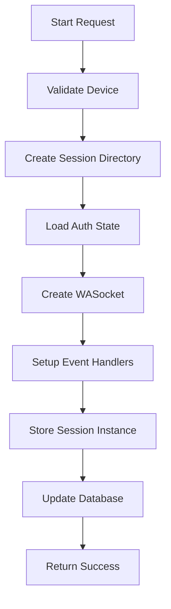
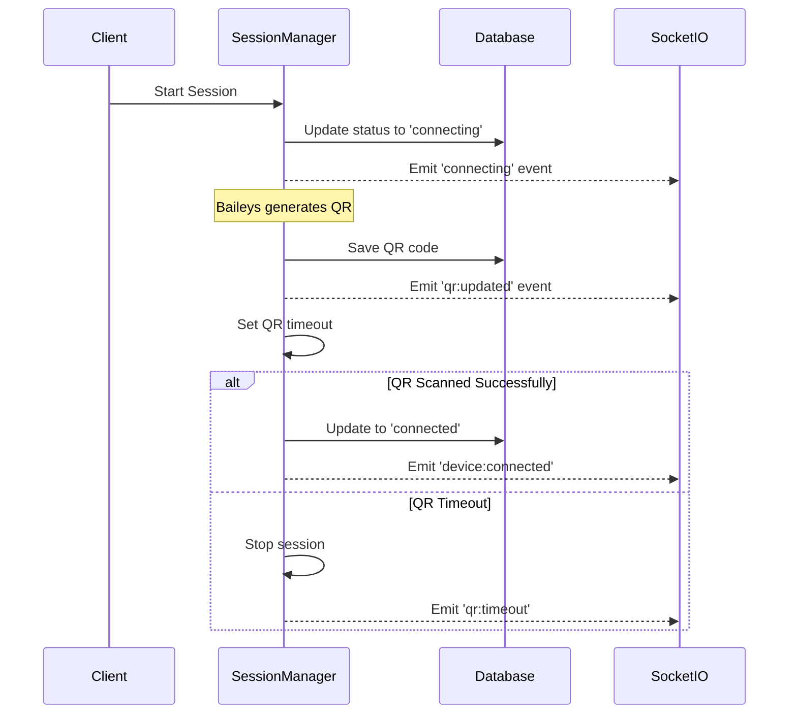

# Session Manager Documentation

## Overview

Session Manager adalah komponen inti yang mengelola multiple Baileys instances untuk WhatsApp Gateway SaaS. Sistem ini dirancang untuk:

- **Multi-User & Multi-Device**: Satu user dapat memiliki banyak device WhatsApp
- **Session Persistence**: Session state disimpan dan dikontrol via MySQL
- **Auto-Reconnect**: Automatic reconnection dengan exponential backoff
- **Real-time Updates**: Integration dengan Socket.IO untuk real-time events
- **Lifecycle Management**: Complete session lifecycle dari start hingga cleanup

## Architecture

### Core Components

1. **SessionManager Class**
   - Singleton pattern untuk global session management
   - Event-driven architecture dengan EventEmitter
   - Memory-efficient session storage dengan Map

2. **Session Instance Structure**
   ```javascript
   {
     socket: WASocket,           // Baileys socket instance
     deviceId: number,           // Device ID dari database
     device: object,             // Device data dari database
     saveCreds: function,        // Baileys credential saver
     status: string,             // Session status
     startedAt: Date,            // Session start time
     lastActivity: Date,         // Last activity timestamp
     reconnectAttempts: number,  // Current reconnect attempts
     qrGenerated: boolean        // QR code generation status
   }
   ```

3. **Database Integration**
   - `sessions` table untuk session metadata
   - `devices` table untuk device status
   - Encrypted auth state storage
   - Activity tracking dan monitoring

## Session Lifecycle

### 1. Session Start Process



**Implementation:**
```javascript
const result = await sessionManager.startSession(deviceId, options);
```

### 2. Connection States

| State | Description | Database Status | Actions |
|-------|-------------|-----------------|---------|
| `starting` | Session initialization | `starting` | Setup socket, load auth |
| `connecting` | Connecting to WhatsApp | `connecting` | Wait for connection |
| `pairing` | Waiting for QR scan | `pairing` | Generate & broadcast QR |
| `connected` | Successfully connected | `active` | Ready for messaging |
| `error` | Connection error | `error` | Log error, attempt reconnect |
| `inactive` | Session stopped | `inactive` | Cleanup resources |

### 3. QR Code Flow



### 4. Auto-Reconnect Mechanism

**Exponential Backoff Strategy:**
```javascript
const delay = reconnectInterval * Math.pow(2, attempts - 1);
// Attempt 1: 5s, Attempt 2: 10s, Attempt 3: 20s, etc.
```

**Reconnect Conditions:**
- Network disconnection
- WhatsApp server issues
- Temporary connection problems

**No Reconnect Conditions:**
- User logged out (`DisconnectReason.loggedOut`)
- Device banned (`DisconnectReason.banned`)
- Max attempts reached

## Event System

### SessionManager Events

```javascript
sessionManager.on('sessionConnected', ({ deviceId, phoneNumber, userInfo }) => {
  // Handle successful connection
});

sessionManager.on('sessionStopped', ({ deviceId, reason }) => {
  // Handle session stop
});

sessionManager.on('qrGenerated', ({ deviceId, qr }) => {
  // Handle QR code generation
});

sessionManager.on('messageReceived', ({ deviceId, message, rawMessage }) => {
  // Handle incoming messages
});
```

### Socket.IO Integration

**Client Events:**
- `device:subscribe` - Subscribe to device updates
- `device:unsubscribe` - Unsubscribe from device
- `device:status` - Request device status
- `qr:request` - Request current QR code

**Server Events:**
- `qr:updated` - New QR code available
- `device:connected` - Device connected successfully
- `device:disconnected` - Device disconnected
- `device:error` - Device error occurred

## Message Handling

### Incoming Messages

```javascript
async processIncomingMessage(sessionInstance, message) {
  // Extract message data
  const messageData = {
    device_id: deviceId,
    message_id: message.key.id,
    from_number: message.key.remoteJid?.split('@')[0],
    type: this.getMessageType(message),
    content: this.getMessageContent(message),
    direction: 'incoming',
    // ... other fields
  };

  // Save to database
  await this.messageRepository.create(messageData);

  // Trigger auto-reply processing
  this.emit('messageReceived', { deviceId, message: messageData });
}
```

### Message Types Support

| Type | Baileys Field | Content Extraction |
|------|---------------|-------------------|
| `text` | `conversation` | Direct text |
| `image` | `imageMessage` | Caption + media URL |
| `video` | `videoMessage` | Caption + media URL |
| `document` | `documentMessage` | Filename + media URL |
| `audio` | `audioMessage` | Media URL |
| `location` | `locationMessage` | Coordinates |
| `contact` | `contactMessage` | Contact info |
| `sticker` | `stickerMessage` | Media URL |

### Outgoing Messages

```javascript
async sendMessage(deviceId, to, message, options = {}) {
  const sessionInstance = this.sessions.get(deviceId);
  
  if (!sessionInstance || sessionInstance.status !== 'connected') {
    throw new Error('Session not connected');
  }
  
  const result = await sessionInstance.socket.sendMessage(to, message, options);
  sessionInstance.lastActivity = new Date();
  
  return result;
}
```

## Security Features

### Auth State Encryption

```javascript
// Encrypt auth state before saving to database
if (this.config.authStateEncryption) {
  authState = encrypt(credsData);
  encrypted = true;
}

await this.sessionRepository.updateAuthState(deviceId, authState, encrypted);
```

### Session Isolation

- Each device has isolated session directory
- Database-level isolation per user/device
- Memory isolation dengan Map structure
- No cross-session data leakage

### Access Control

- JWT-based Socket.IO authentication
- Device ownership verification
- API key validation
- Rate limiting per session

## Performance Optimization

### Memory Management

```javascript
// Cleanup inactive sessions
async cleanupInactiveSessions() {
  const now = new Date();
  
  for (const [deviceId, sessionInstance] of this.sessions) {
    const inactiveTime = now - sessionInstance.lastActivity;
    
    if (inactiveTime > this.config.sessionTimeout) {
      await this.stopSession(deviceId, 'timeout');
    }
  }
}
```

### Database Optimization

- Indexed queries untuk session lookup
- Batch updates untuk activity tracking
- Efficient auth state storage
- Connection pooling

### Resource Monitoring

- Session count tracking
- Memory usage monitoring
- Connection health checks
- Performance metrics collection

## Configuration

### Environment Variables

```env
# Session Configuration
WA_SESSION_TIMEOUT=300000          # 5 minutes
WA_RECONNECT_INTERVAL=5000         # 5 seconds
WA_MAX_RECONNECT_ATTEMPTS=5        # Max attempts
WA_QR_TIMEOUT=60000               # 1 minute
WA_AUTH_STATE_ENCRYPTION=true     # Enable encryption
```

### Runtime Configuration

```javascript
const config = {
  maxReconnectAttempts: 5,
  reconnectInterval: 5000,
  sessionTimeout: 300000,
  qrTimeout: 60000,
  authStateEncryption: true
};
```

## Error Handling

### Connection Errors

```javascript
// Handle different disconnect reasons
if (reason === DisconnectReason.loggedOut) {
  // User logged out - stop session permanently
} else if (reason === DisconnectReason.banned) {
  // Device banned - mark as banned
} else if (shouldReconnect && attempts < maxAttempts) {
  // Attempt reconnection
} else {
  // Max attempts reached - mark as error
}
```

### Error Recovery

- Automatic retry dengan exponential backoff
- Graceful degradation untuk partial failures
- Error logging dan monitoring
- User notification via Socket.IO

## Monitoring & Logging

### Session Metrics

```javascript
// Get session statistics
const stats = {
  totalSessions: this.sessions.size,
  connectedSessions: connectedCount,
  reconnectingSessions: reconnectingCount,
  errorSessions: errorCount
};
```

### Health Checks

```javascript
// Session health monitoring
async getSessionHealth() {
  return {
    activeSessions: this.sessions.size,
    memoryUsage: process.memoryUsage(),
    uptime: process.uptime(),
    lastCleanup: this.lastCleanup
  };
}
```

## Best Practices

### Session Management

1. **Always check session status** before operations
2. **Handle reconnection gracefully** dengan user feedback
3. **Implement proper cleanup** untuk resource management
4. **Monitor session health** dengan automated alerts
5. **Use event-driven architecture** untuk loose coupling

### Error Handling

1. **Implement comprehensive error logging**
2. **Provide meaningful error messages** ke user
3. **Handle edge cases** seperti network issues
4. **Implement circuit breaker pattern** untuk stability
5. **Monitor error rates** dan patterns

### Performance

1. **Limit concurrent sessions** per server
2. **Implement session pooling** untuk efficiency
3. **Use database indexing** untuk fast lookups
4. **Monitor memory usage** dan implement limits
5. **Implement graceful shutdown** procedures

## Troubleshooting

### Common Issues

| Issue | Symptoms | Solution |
|-------|----------|----------|
| Session won't start | Error in logs, status stuck | Check device permissions, restart |
| QR not generating | No QR events | Verify Baileys version, check auth state |
| Frequent disconnects | Reconnect loops | Check network stability, review logs |
| Memory leaks | Increasing memory usage | Implement proper cleanup, monitor sessions |
| Database errors | Session state issues | Check DB connection, verify schema |

### Debug Mode

```javascript
// Enable debug logging
const logger = require('../utils/logger');
logger.level = 'debug';

// Monitor session events
sessionManager.on('*', (event, data) => {
  logger.debug('SessionManager Event:', event, data);
});
```

### Health Monitoring

```javascript
// Regular health checks
setInterval(async () => {
  const health = await sessionManager.getSessionHealth();
  if (health.errorRate > 0.1) {
    logger.warn('High session error rate detected:', health);
  }
}, 60000);
```