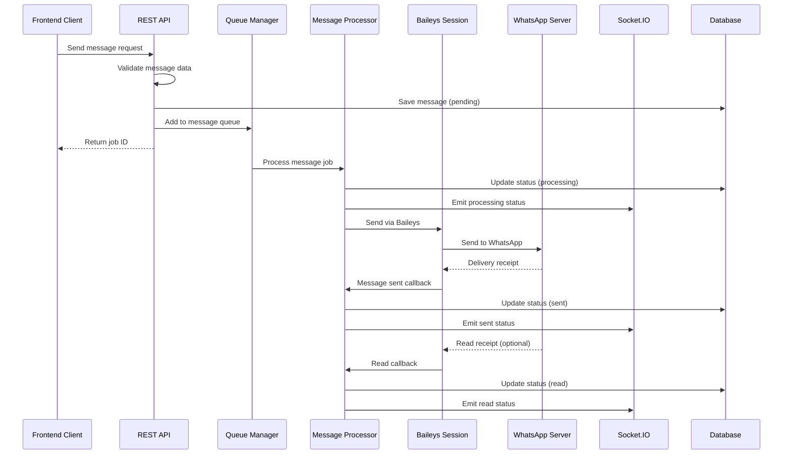

# Single Message Flow Design

## Overview

Single Message Flow adalah sistem pengiriman pesan WhatsApp yang mendukung berbagai tipe pesan dengan tracking delivery real-time:

- **Text Messages** - Pesan teks biasa dan formatted
- **Media Messages** - Image, video, document, audio
- **Location Messages** - Koordinat lokasi
- **Contact Messages** - Sharing kontak vCard
- **List Messages** - Interactive list messages
- **Sticker Messages** - Sticker dan emoji

## Architecture

### Message Flow Pipeline



### Message Types & Formats

#### 1. Text Message
```javascript
{
  type: 'text',
  to: '628123456789@s.whatsapp.net',
  content: {
    text: 'Hello World!'
  }
}
```

#### 2. Image Message
```javascript
{
  type: 'image',
  to: '628123456789@s.whatsapp.net',
  content: {
    image: {
      url: 'https://example.com/image.jpg',
      // or buffer: Buffer.from(imageData),
      // or path: '/path/to/image.jpg'
    },
    caption: 'Image caption (optional)'
  }
}
```

#### 3. Video Message
```javascript
{
  type: 'video',
  to: '628123456789@s.whatsapp.net',
  content: {
    video: {
      url: 'https://example.com/video.mp4'
    },
    caption: 'Video caption (optional)',
    gifPlayback: false // true for GIF
  }
}
```

#### 4. Document Message
```javascript
{
  type: 'document',
  to: '628123456789@s.whatsapp.net',
  content: {
    document: {
      url: 'https://example.com/document.pdf'
    },
    fileName: 'document.pdf',
    mimetype: 'application/pdf'
  }
}
```

#### 5. Audio Message
```javascript
{
  type: 'audio',
  to: '628123456789@s.whatsapp.net',
  content: {
    audio: {
      url: 'https://example.com/audio.mp3'
    },
    mimetype: 'audio/mp3',
    ptt: false // true for voice note
  }
}
```

#### 6. Location Message
```javascript
{
  type: 'location',
  to: '628123456789@s.whatsapp.net',
  content: {
    location: {
      degreesLatitude: -6.2088,
      degreesLongitude: 106.8456,
      name: 'Jakarta, Indonesia (optional)',
      address: 'Jakarta, DKI Jakarta, Indonesia (optional)'
    }
  }
}
```

#### 7. Contact Message
```javascript
{
  type: 'contact',
  to: '628123456789@s.whatsapp.net',
  content: {
    contacts: {
      displayName: 'John Doe',
      contacts: [{
        vcard: 'BEGIN:VCARD\nVERSION:3.0\nFN:John Doe\nTEL:+628123456789\nEND:VCARD'
      }]
    }
  }
}
```

#### 8. List Message
```javascript
{
  type: 'list',
  to: '628123456789@s.whatsapp.net',
  content: {
    text: 'Choose an option:',
    buttonText: 'Select',
    sections: [{
      title: 'Section 1',
      rows: [{
        title: 'Option 1',
        description: 'Description for option 1',
        rowId: 'option_1'
      }]
    }]
  }
}
```

#### 9. Sticker Message
```javascript
{
  type: 'sticker',
  to: '628123456789@s.whatsapp.net',
  content: {
    sticker: {
      url: 'https://example.com/sticker.webp'
    }
  }
}
```

## Message Processing Pipeline

### 1. Message Validation
```javascript
const validateMessage = (messageData) => {
  const errors = [];
  
  // Validate recipient
  if (!messageData.to || !isValidWhatsAppId(messageData.to)) {
    errors.push('Invalid recipient');
  }
  
  // Validate message type
  if (!SUPPORTED_MESSAGE_TYPES.includes(messageData.type)) {
    errors.push('Unsupported message type');
  }
  
  // Type-specific validation
  switch (messageData.type) {
    case 'text':
      if (!messageData.content.text || messageData.content.text.length > 4096) {
        errors.push('Text message must be 1-4096 characters');
      }
      break;
      
    case 'image':
      if (!messageData.content.image) {
        errors.push('Image content is required');
      }
      break;
      
    case 'location':
      const { degreesLatitude, degreesLongitude } = messageData.content.location;
      if (!isValidLatitude(degreesLatitude) || !isValidLongitude(degreesLongitude)) {
        errors.push('Invalid coordinates');
      }
      break;
  }
  
  return {
    isValid: errors.length === 0,
    errors: errors
  };
};
```

### 2. Media Processing
```javascript
const processMediaMessage = async (messageData) => {
  const { type, content } = messageData;
  
  if (!MEDIA_TYPES.includes(type)) {
    return messageData;
  }
  
  const mediaKey = type; // 'image', 'video', 'document', 'audio', 'sticker'
  const mediaData = content[mediaKey];
  
  // Handle different media sources
  if (mediaData.url) {
    // Download from URL
    const buffer = await downloadMedia(mediaData.url);
    return {
      ...messageData,
      content: {
        ...content,
        [mediaKey]: buffer
      }
    };
  } else if (mediaData.path) {
    // Read from file path
    const buffer = await fs.readFile(mediaData.path);
    return {
      ...messageData,
      content: {
        ...content,
        [mediaKey]: buffer
      }
    };
  } else if (mediaData.buffer || Buffer.isBuffer(mediaData)) {
    // Already a buffer
    return messageData;
  }
  
  throw new Error(`Invalid media source for ${type} message`);
};
```

### 3. Message Formatting
```javascript
const formatMessageForBaileys = (messageData) => {
  const { type, content } = messageData;
  
  switch (type) {
    case 'text':
      return { text: content.text };
      
    case 'image':
      return {
        image: content.image,
        caption: content.caption || ''
      };
      
    case 'video':
      return {
        video: content.video,
        caption: content.caption || '',
        gifPlayback: content.gifPlayback || false
      };
      
    case 'document':
      return {
        document: content.document,
        fileName: content.fileName || 'document',
        mimetype: content.mimetype || 'application/octet-stream'
      };
      
    case 'audio':
      return {
        audio: content.audio,
        mimetype: content.mimetype || 'audio/mp4',
        ptt: content.ptt || false
      };
      
    case 'location':
      return {
        location: content.location
      };
      
    case 'contact':
      return {
        contacts: content.contacts
      };
      
    case 'list':
      return {
        text: content.text,
        buttonText: content.buttonText,
        sections: content.sections
      };
      
    case 'sticker':
      return {
        sticker: content.sticker
      };
      
    default:
      throw new Error(`Unsupported message type: ${type}`);
  }
};
```

### 4. Delivery Tracking
```javascript
const trackMessageDelivery = async (messageId, status, timestamp) => {
  const updateData = {
    status: status,
    updated_at: new Date()
  };
  
  switch (status) {
    case 'sent':
      updateData.sent_at = timestamp;
      break;
    case 'delivered':
      updateData.delivered_at = timestamp;
      break;
    case 'read':
      updateData.read_at = timestamp;
      break;
    case 'failed':
      updateData.failed_at = timestamp;
      break;
  }
  
  await messageRepository.updateByMessageId(messageId, updateData);
  
  // Emit real-time update
  socketManager.emitToDevice(deviceId, 'message:status_updated', {
    messageId: messageId,
    status: status,
    timestamp: timestamp
  });
};
```

## Message Status Lifecycle

### Status Flow
```
pending → processing → sent → delivered → read
                    ↓
                  failed
```

### Status Definitions
- **pending**: Message queued for sending
- **processing**: Message being processed by worker
- **sent**: Message sent to WhatsApp servers
- **delivered**: Message delivered to recipient's device
- **read**: Message read by recipient
- **failed**: Message sending failed

### Status Tracking Implementation
```javascript
class MessageStatusTracker {
  constructor(messageId, deviceId) {
    this.messageId = messageId;
    this.deviceId = deviceId;
    this.statusHistory = [];
  }
  
  async updateStatus(status, metadata = {}) {
    const timestamp = new Date();
    
    // Add to history
    this.statusHistory.push({
      status: status,
      timestamp: timestamp,
      metadata: metadata
    });
    
    // Update database
    await this.updateDatabase(status, timestamp, metadata);
    
    // Emit real-time event
    await this.emitStatusUpdate(status, timestamp, metadata);
    
    // Trigger webhooks if configured
    await this.triggerWebhooks(status, timestamp, metadata);
  }
  
  async updateDatabase(status, timestamp, metadata) {
    const updateData = {
      status: status,
      updated_at: timestamp
    };
    
    // Add timestamp fields based on status
    if (status === 'sent') updateData.sent_at = timestamp;
    if (status === 'delivered') updateData.delivered_at = timestamp;
    if (status === 'read') updateData.read_at = timestamp;
    if (status === 'failed') {
      updateData.failed_at = timestamp;
      updateData.error_message = metadata.error || null;
    }
    
    await messageRepository.updateByMessageId(this.messageId, updateData);
  }
  
  async emitStatusUpdate(status, timestamp, metadata) {
    socketManager.emitToDevice(this.deviceId, 'message:status_updated', {
      messageId: this.messageId,
      status: status,
      timestamp: timestamp,
      metadata: metadata
    });
  }
  
  async triggerWebhooks(status, timestamp, metadata) {
    // Get user's webhook configuration
    const webhookConfig = await getUserWebhookConfig(this.deviceId);
    
    if (webhookConfig && webhookConfig.message_status_enabled) {
      const queueManager = QueueManager.getInstance();
      
      await queueManager.addWebhookJob({
        type: 'message_status',
        webhookUrl: webhookConfig.url,
        messageId: this.messageId,
        deviceId: this.deviceId,
        status: status,
        timestamp: timestamp,
        metadata: metadata,
        secret: webhookConfig.secret
      });
    }
  }
}
```

## Bulk Message Support

### Bulk Message Structure
```javascript
{
  type: 'bulk',
  messages: [
    {
      to: '628123456789@s.whatsapp.net',
      type: 'text',
      content: { text: 'Hello John!' }
    },
    {
      to: '628987654321@s.whatsapp.net',
      type: 'image',
      content: {
        image: { url: 'https://example.com/image.jpg' },
        caption: 'Check this out!'
      }
    }
  ],
  options: {
    delay: 1000, // ms between messages
    randomDelay: true, // randomize delay
    stopOnError: false // continue on individual failures
  }
}
```

### Bulk Processing Logic
```javascript
const processBulkMessages = async (bulkData, job) => {
  const { messages, options = {} } = bulkData;
  const results = [];
  
  const delay = options.delay || 1000;
  const randomDelay = options.randomDelay || false;
  const stopOnError = options.stopOnError || false;
  
  for (let i = 0; i < messages.length; i++) {
    const messageData = messages[i];
    
    try {
      // Add delay between messages
      if (i > 0) {
        const actualDelay = randomDelay 
          ? delay + Math.random() * delay 
          : delay;
        await sleep(actualDelay);
      }
      
      // Process individual message
      const result = await processSingleMessage(messageData);
      results.push({
        index: i,
        success: true,
        result: result
      });
      
      // Update job progress
      const progress = Math.round(((i + 1) / messages.length) * 100);
      job.progress(progress);
      
    } catch (error) {
      results.push({
        index: i,
        success: false,
        error: error.message,
        messageData: messageData
      });
      
      if (stopOnError) {
        break;
      }
    }
  }
  
  return {
    success: true,
    total: messages.length,
    successful: results.filter(r => r.success).length,
    failed: results.filter(r => !r.success).length,
    results: results
  };
};
```

## Message Templates

### Template System
```javascript
class MessageTemplate {
  constructor(templateData) {
    this.id = templateData.id;
    this.name = templateData.name;
    this.type = templateData.type;
    this.content = templateData.content;
    this.variables = templateData.variables || [];
  }
  
  render(variables = {}) {
    let renderedContent = { ...this.content };
    
    // Replace variables in text content
    if (renderedContent.text) {
      renderedContent.text = this.replaceVariables(renderedContent.text, variables);
    }
    
    // Replace variables in caption
    if (renderedContent.caption) {
      renderedContent.caption = this.replaceVariables(renderedContent.caption, variables);
    }
    
    return {
      type: this.type,
      content: renderedContent
    };
  }
  
  replaceVariables(text, variables) {
    let result = text;
    
    // Replace {{variable}} patterns
    for (const [key, value] of Object.entries(variables)) {
      const pattern = new RegExp(`{{${key}}}`, 'g');
      result = result.replace(pattern, value);
    }
    
    return result;
  }
  
  validate(variables = {}) {
    const errors = [];
    
    // Check required variables
    for (const variable of this.variables) {
      if (variable.required && !variables[variable.name]) {
        errors.push(`Required variable '${variable.name}' is missing`);
      }
    }
    
    return {
      isValid: errors.length === 0,
      errors: errors
    };
  }
}

// Template usage example
const template = new MessageTemplate({
  id: 1,
  name: 'Welcome Message',
  type: 'text',
  content: {
    text: 'Hello {{name}}! Welcome to {{company}}. Your account ID is {{account_id}}.'
  },
  variables: [
    { name: 'name', required: true },
    { name: 'company', required: true },
    { name: 'account_id', required: true }
  ]
});

const message = template.render({
  name: 'John Doe',
  company: 'ACME Corp',
  account_id: '12345'
});
```

## Message Scheduling

### Scheduled Message Structure
```javascript
{
  type: 'scheduled',
  scheduledAt: '2024-01-20T10:00:00Z',
  timezone: 'Asia/Jakarta',
  message: {
    to: '628123456789@s.whatsapp.net',
    type: 'text',
    content: { text: 'Good morning!' }
  }
}
```

### Scheduling Implementation
```javascript
const scheduleMessage = async (messageData, scheduledAt, timezone = 'UTC') => {
  const scheduledTime = moment.tz(scheduledAt, timezone);
  const now = moment();
  
  if (scheduledTime.isBefore(now)) {
    throw new Error('Scheduled time must be in the future');
  }
  
  const delay = scheduledTime.diff(now);
  
  // Add to queue with delay
  const job = await queueManager.addMessageJob({
    type: 'send_message',
    ...messageData
  }, {
    delay: delay,
    jobId: `scheduled_${Date.now()}_${Math.random()}`
  });
  
  // Save scheduled message record
  await messageRepository.create({
    ...messageData,
    status: 'scheduled',
    scheduled_at: scheduledTime.toDate(),
    job_id: job.id
  });
  
  return {
    success: true,
    jobId: job.id,
    scheduledAt: scheduledTime.toISOString(),
    delay: delay
  };
};
```

## Error Handling & Retry Logic

### Error Classification
```javascript
const classifyMessageError = (error) => {
  const errorMessage = error.message.toLowerCase();
  
  if (errorMessage.includes('rate limit')) {
    return {
      type: 'RATE_LIMIT',
      retryable: true,
      retryDelay: 60000 // 1 minute
    };
  }
  
  if (errorMessage.includes('network') || errorMessage.includes('timeout')) {
    return {
      type: 'NETWORK_ERROR',
      retryable: true,
      retryDelay: 5000 // 5 seconds
    };
  }
  
  if (errorMessage.includes('invalid number') || errorMessage.includes('not registered')) {
    return {
      type: 'INVALID_RECIPIENT',
      retryable: false
    };
  }
  
  if (errorMessage.includes('media too large') || errorMessage.includes('file size')) {
    return {
      type: 'MEDIA_TOO_LARGE',
      retryable: false
    };
  }
  
  if (errorMessage.includes('session') || errorMessage.includes('not connected')) {
    return {
      type: 'SESSION_ERROR',
      retryable: true,
      retryDelay: 10000 // 10 seconds
    };
  }
  
  return {
    type: 'UNKNOWN_ERROR',
    retryable: true,
    retryDelay: 30000 // 30 seconds
  };
};
```

### Retry Implementation
```javascript
const sendMessageWithRetry = async (messageData, maxRetries = 3) => {
  let lastError;
  
  for (let attempt = 1; attempt <= maxRetries; attempt++) {
    try {
      const result = await sendMessage(messageData);
      return result;
      
    } catch (error) {
      lastError = error;
      const errorInfo = classifyMessageError(error);
      
      if (!errorInfo.retryable || attempt === maxRetries) {
        throw error;
      }
      
      logger.warn(`Message send attempt ${attempt} failed, retrying in ${errorInfo.retryDelay}ms:`, error.message);
      
      // Wait before retry
      await sleep(errorInfo.retryDelay);
    }
  }
  
  throw lastError;
};
```

## Real-time Events

### Socket.IO Message Events
```javascript
// Message queued
socket.emit('message:queued', {
  messageId: 'msg_123',
  jobId: 'job_456',
  to: '628123456789',
  type: 'text',
  queuePosition: 5,
  estimatedDelay: 30000,
  timestamp: new Date()
});

// Message processing
socket.emit('message:processing', {
  messageId: 'msg_123',
  jobId: 'job_456',
  status: 'processing',
  timestamp: new Date()
});

// Message sent
socket.emit('message:sent', {
  messageId: 'msg_123',
  baileyMessageId: 'BAE5F4B0C1D2E3F4',
  to: '628123456789',
  status: 'sent',
  timestamp: new Date()
});

// Message delivered
socket.emit('message:delivered', {
  messageId: 'msg_123',
  baileyMessageId: 'BAE5F4B0C1D2E3F4',
  status: 'delivered',
  timestamp: new Date()
});

// Message read
socket.emit('message:read', {
  messageId: 'msg_123',
  baileyMessageId: 'BAE5F4B0C1D2E3F4',
  status: 'read',
  timestamp: new Date()
});

// Message failed
socket.emit('message:failed', {
  messageId: 'msg_123',
  jobId: 'job_456',
  error: 'Invalid recipient number',
  errorType: 'INVALID_RECIPIENT',
  retryable: false,
  timestamp: new Date()
});

// Bulk message progress
socket.emit('message:bulk_progress', {
  bulkId: 'bulk_789',
  total: 100,
  sent: 45,
  delivered: 30,
  failed: 2,
  remaining: 55,
  percentage: 45,
  timestamp: new Date()
});
```

## Performance Optimization

### Message Queue Optimization
```javascript
// Priority-based queuing
const addMessageWithPriority = async (messageData, priority = 0) => {
  // Higher priority = processed first
  // 0 = normal, 5 = high, 10 = urgent
  
  return await queueManager.addMessageJob(messageData, {
    priority: priority,
    attempts: 3,
    backoff: {
      type: 'exponential',
      delay: 2000
    }
  });
};

// Batch processing for efficiency
const processBatchedMessages = async (messages) => {
  const batches = chunkArray(messages, 10); // 10 messages per batch
  
  for (const batch of batches) {
    await Promise.all(
      batch.map(message => processMessage(message))
    );
    
    // Small delay between batches to avoid rate limits
    await sleep(1000);
  }
};
```

### Media Optimization
```javascript
const optimizeMedia = async (mediaBuffer, type) => {
  switch (type) {
    case 'image':
      // Compress image if too large
      if (mediaBuffer.length > 5 * 1024 * 1024) { // 5MB
        return await compressImage(mediaBuffer, {
          quality: 80,
          maxWidth: 1920,
          maxHeight: 1080
        });
      }
      break;
      
    case 'video':
      // Compress video if too large
      if (mediaBuffer.length > 16 * 1024 * 1024) { // 16MB
        return await compressVideo(mediaBuffer, {
          quality: 'medium',
          maxDuration: 300 // 5 minutes
        });
      }
      break;
  }
  
  return mediaBuffer;
};
```

## API Integration

### REST API Endpoints
```javascript
// Send single message
POST /api/v1/messages/send
{
  "device_id": 123,
  "to": "628123456789",
  "type": "text",
  "content": {
    "text": "Hello World!"
  }
}

// Send bulk messages
POST /api/v1/messages/send-bulk
{
  "device_id": 123,
  "messages": [...],
  "options": {
    "delay": 1000,
    "randomDelay": true
  }
}

// Schedule message
POST /api/v1/messages/schedule
{
  "device_id": 123,
  "scheduled_at": "2024-01-20T10:00:00Z",
  "timezone": "Asia/Jakarta",
  "message": {...}
}

// Get message status
GET /api/v1/messages/:messageId/status

// Get message history
GET /api/v1/messages?device_id=123&limit=50&offset=0

// Cancel scheduled message
DELETE /api/v1/messages/:messageId/cancel
```

---

## Implementation Plan

1. **Enhanced MessageJob.js** - Extend existing message job with new message types
2. **MessageService.js** - Business logic layer for message management
3. **MessageController.js** - Enhanced API endpoints for all message types
4. **Message validation utilities** - Comprehensive validation for all message types
5. **Media processing utilities** - Media download, optimization, and validation
6. **Template system** - Message templates with variable substitution
7. **Scheduling system** - Delayed message sending with timezone support
8. **Real-time Socket.IO events** - Enhanced message status tracking
9. **Bulk message processing** - Efficient bulk message handling
10. **Performance optimizations** - Queue management and media optimization

Next: Implementation of enhanced MessageJob and related components.