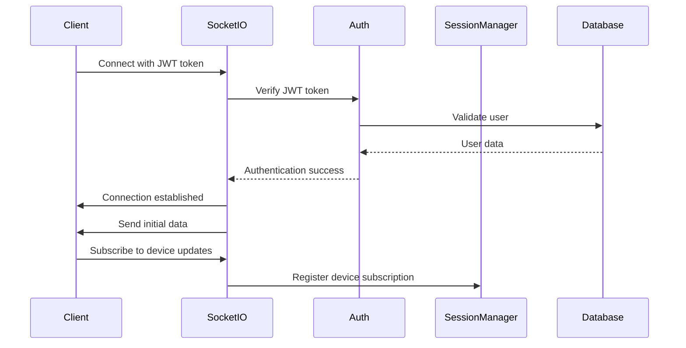

# Socket.IO Integration Documentation

## Overview

Socket.IO integration menyediakan real-time communication antara backend dan frontend untuk:

- **QR Code Real-time**: Live QR code updates untuk device pairing
- **Device Status**: Real-time device connection status
- **Session Lifecycle**: Live session events dan notifications
- **Message Notifications**: Real-time message updates
- **Campaign Progress**: Live campaign execution updates
- **System Notifications**: Global system alerts

## Architecture

### Connection Flow



### Event Categories

1. **Authentication Events**
   - Connection establishment
   - Token validation
   - User session management

2. **Device Events**
   - Device status updates
   - QR code generation
   - Connection state changes

3. **Message Events**
   - Incoming message notifications
   - Message status updates
   - Auto-reply triggers

4. **Campaign Events**
   - Campaign progress updates
   - Target completion status
   - Campaign statistics

5. **System Events**
   - Global notifications
   - System health updates
   - Maintenance alerts

## Event Specifications

### Client → Server Events

#### Authentication & Connection
```javascript
// Initial connection with JWT token
socket.auth = { token: 'jwt_token_here' };

// Ping for connection health
socket.emit('ping');
// Response: socket.on('pong', (data) => { timestamp })
```

#### Device Management
```javascript
// Subscribe to device updates
socket.emit('device:subscribe', { deviceId: 123 });
// Response: socket.on('device:subscribed', { deviceId })

// Unsubscribe from device updates
socket.emit('device:unsubscribe', { deviceId: 123 });
// Response: socket.on('device:unsubscribed', { deviceId })

// Request current device status
socket.emit('device:status', { deviceId: 123 });
// Response: socket.on('device:status', { deviceId, device, session })

// Request QR code
socket.emit('qr:request', { deviceId: 123 });
// Response: socket.on('qr:updated', { deviceId, qr, timestamp })
//       or: socket.on('qr:unavailable', { deviceId })
```

#### Session Control
```javascript
// Start device session
socket.emit('session:start', { deviceId: 123 });
// Response: socket.on('session:started', { deviceId, success, message })

// Stop device session
socket.emit('session:stop', { deviceId: 123 });
// Response: socket.on('session:stopped', { deviceId, success, message })

// Restart device session
socket.emit('session:restart', { deviceId: 123 });
// Response: socket.on('session:restarted', { deviceId, success, message })
```

### Server → Client Events

#### Initial Data
```javascript
socket.on('initial:data', (data) => {
  /*
  {
    user: { id, name, email },
    devices: {
      deviceId: {
        device: { id, name, phone_number, status, last_seen },
        session: { status, connected, startedAt, lastActivity }
      }
    },
    timestamp: Date
  }
  */
});
```

#### QR Code Events
```javascript
// New QR code generated
socket.on('qr:updated', (data) => {
  /*
  {
    deviceId: 123,
    qr: 'data:image/png;base64,...',
    timestamp: Date
  }
  */
});

// QR code expired or unavailable
socket.on('qr:unavailable', (data) => {
  /*
  {
    deviceId: 123,
    reason: 'expired' | 'not_generated' | 'connected'
  }
  */
});

// QR code timeout
socket.on('qr:timeout', (data) => {
  /*
  {
    deviceId: 123,
    message: 'QR code expired, please restart session'
  }
  */
});
```

#### Device Status Events
```javascript
// Device connected successfully
socket.on('device:connected', (data) => {
  /*
  {
    deviceId: 123,
    phoneNumber: '628123456789',
    userInfo: { id, name, ... },
    timestamp: Date
  }
  */
});

// Device disconnected
socket.on('device:disconnected', (data) => {
  /*
  {
    deviceId: 123,
    reason: 'manual' | 'network' | 'logout' | 'timeout',
    timestamp: Date
  }
  */
});

// Device logged out
socket.on('device:logged_out', (data) => {
  /*
  {
    deviceId: 123,
    message: 'Device was logged out from WhatsApp',
    timestamp: Date
  }
  */
});

// Device banned
socket.on('device:banned', (data) => {
  /*
  {
    deviceId: 123,
    message: 'Device was banned by WhatsApp',
    timestamp: Date
  }
  */
});

// Device error
socket.on('device:error', (data) => {
  /*
  {
    deviceId: 123,
    reason: 'connection_failed' | 'auth_error' | 'unknown',
    message: 'Error description',
    timestamp: Date
  }
  */
});

// Device status update
socket.on('device:status', (data) => {
  /*
  {
    deviceId: 123,
    device: {
      id: 123,
      name: 'My Device',
      phone_number: '628123456789',
      status: 'connected' | 'disconnected' | 'connecting' | 'pairing' | 'banned' | 'error',
      last_seen: Date
    },
    session: {
      status: 'connected' | 'connecting' | 'pairing' | 'inactive',
      connected: boolean,
      startedAt: Date,
      lastActivity: Date,
      reconnectAttempts: number,
      qrGenerated: boolean
    }
  }
  */
});
```

#### Message Events
```javascript
// New message received
socket.on('message:received', (data) => {
  /*
  {
    deviceId: 123,
    message: {
      id: 'msg_id',
      from_number: '628123456789',
      content: 'Hello world',
      type: 'text',
      is_group: false,
      timestamp: Date
    }
  }
  */
});

// Message status updated
socket.on('message:status', (data) => {
  /*
  {
    deviceId: 123,
    messageId: 'msg_id',
    status: 'sent' | 'delivered' | 'read' | 'failed',
    timestamp: Date
  }
  */
});

// Auto-reply triggered
socket.on('message:auto_reply', (data) => {
  /*
  {
    deviceId: 123,
    trigger: {
      from_number: '628123456789',
      message: 'trigger text'
    },
    response: {
      text: 'auto reply text',
      type: 'text'
    }
  }
  */
});
```

#### Campaign Events
```javascript
// Campaign started
socket.on('campaign:started', (data) => {
  /*
  {
    campaignId: 456,
    deviceId: 123,
    name: 'Campaign Name',
    totalTargets: 100,
    timestamp: Date
  }
  */
});

// Campaign progress update
socket.on('campaign:progress', (data) => {
  /*
  {
    campaignId: 456,
    deviceId: 123,
    progress: {
      total: 100,
      sent: 45,
      delivered: 30,
      failed: 2,
      remaining: 55,
      percentage: 45
    },
    timestamp: Date
  }
  */
});

// Campaign completed
socket.on('campaign:completed', (data) => {
  /*
  {
    campaignId: 456,
    deviceId: 123,
    stats: {
      total: 100,
      sent: 98,
      delivered: 95,
      failed: 2,
      duration: 1800000 // ms
    },
    timestamp: Date
  }
  */
});

// Campaign paused/stopped
socket.on('campaign:stopped', (data) => {
  /*
  {
    campaignId: 456,
    deviceId: 123,
    reason: 'manual' | 'error' | 'device_disconnected',
    stats: { ... },
    timestamp: Date
  }
  */
});
```

#### System Events
```javascript
// System notification
socket.on('system:notification', (data) => {
  /*
  {
    message: 'System maintenance in 10 minutes',
    level: 'info' | 'warn' | 'error',
    timestamp: Date
  }
  */
});

// Device notification
socket.on('device:notification', (data) => {
  /*
  {
    deviceId: 123,
    type: 'info' | 'warning' | 'error',
    data: { ... },
    timestamp: Date
  }
  */
});

// Error events
socket.on('error', (data) => {
  /*
  {
    message: 'Error description',
    code: 'ERROR_CODE',
    details: { ... }
  }
  */
});
```

## Room Management

### Room Structure
```javascript
// User-specific room
`user:${userId}` - All sockets for a specific user

// Device-specific room
`device:${deviceId}` - All sockets subscribed to a device

// Global rooms
`system` - System-wide notifications
`admin` - Admin-only notifications
```

### Subscription Management
```javascript
class SocketManager {
  // Track subscriptions
  connectedClients = new Map(); // userId -> Set of socket ids
  deviceSubscriptions = new Map(); // deviceId -> Set of socket ids
  
  // Subscribe to device
  subscribeToDevice(socket, deviceId) {
    socket.join(`device:${deviceId}`);
    
    if (!this.deviceSubscriptions.has(deviceId)) {
      this.deviceSubscriptions.set(deviceId, new Set());
    }
    this.deviceSubscriptions.get(deviceId).add(socket.id);
  }
  
  // Emit to device subscribers
  emitToDevice(deviceId, event, data) {
    this.io.to(`device:${deviceId}`).emit(event, { deviceId, ...data });
  }
}
```

## Authentication & Security

### JWT Authentication
```javascript
// Middleware for socket authentication
io.use(async (socket, next) => {
  try {
    const token = socket.handshake.auth.token;
    const decoded = jwt.verify(token, process.env.JWT_SECRET);
    const user = await userRepository.findById(decoded.userId);
    
    if (!user || !user.is_active) {
      return next(new Error('Invalid user'));
    }
    
    socket.userId = user.id;
    socket.user = user;
    next();
  } catch (error) {
    next(new Error('Authentication failed'));
  }
});
```

### Device Access Control
```javascript
// Verify device ownership before subscription
socket.on('device:subscribe', async (data) => {
  const device = await deviceRepository.findByIdAndUserId(
    data.deviceId, 
    socket.userId
  );
  
  if (!device) {
    socket.emit('error', { message: 'Device not found or access denied' });
    return;
  }
  
  // Proceed with subscription
});
```

### Rate Limiting
```javascript
// Rate limiting per socket
const rateLimiter = new Map(); // socketId -> { count, resetTime }

socket.use((packet, next) => {
  const socketId = socket.id;
  const now = Date.now();
  const limit = rateLimiter.get(socketId) || { count: 0, resetTime: now + 60000 };
  
  if (now > limit.resetTime) {
    limit.count = 0;
    limit.resetTime = now + 60000;
  }
  
  if (limit.count >= 100) { // 100 requests per minute
    return next(new Error('Rate limit exceeded'));
  }
  
  limit.count++;
  rateLimiter.set(socketId, limit);
  next();
});
```

## Frontend Integration Examples

### React Hook for Socket.IO
```javascript
import { useEffect, useState } from 'react';
import io from 'socket.io-client';

export const useSocket = (token) => {
  const [socket, setSocket] = useState(null);
  const [connected, setConnected] = useState(false);
  const [devices, setDevices] = useState({});

  useEffect(() => {
    if (!token) return;

    const newSocket = io(process.env.REACT_APP_SOCKET_URL, {
      auth: { token },
      transports: ['websocket', 'polling']
    });

    newSocket.on('connect', () => {
      setConnected(true);
      console.log('Socket connected');
    });

    newSocket.on('disconnect', () => {
      setConnected(false);
      console.log('Socket disconnected');
    });

    newSocket.on('initial:data', (data) => {
      setDevices(data.devices);
    });

    newSocket.on('device:status', (data) => {
      setDevices(prev => ({
        ...prev,
        [data.deviceId]: data
      }));
    });

    setSocket(newSocket);

    return () => {
      newSocket.close();
    };
  }, [token]);

  return { socket, connected, devices };
};
```

### QR Code Component
```javascript
import React, { useEffect, useState } from 'react';
import { useSocket } from './useSocket';

export const QRCodeDisplay = ({ deviceId }) => {
  const { socket } = useSocket();
  const [qrCode, setQrCode] = useState(null);
  const [status, setStatus] = useState('loading');

  useEffect(() => {
    if (!socket || !deviceId) return;

    // Subscribe to device updates
    socket.emit('device:subscribe', { deviceId });

    // Request current QR code
    socket.emit('qr:request', { deviceId });

    // Listen for QR updates
    socket.on('qr:updated', (data) => {
      if (data.deviceId === deviceId) {
        setQrCode(data.qr);
        setStatus('waiting');
      }
    });

    socket.on('qr:unavailable', (data) => {
      if (data.deviceId === deviceId) {
        setQrCode(null);
        setStatus('unavailable');
      }
    });

    socket.on('device:connected', (data) => {
      if (data.deviceId === deviceId) {
        setQrCode(null);
        setStatus('connected');
      }
    });

    return () => {
      socket.emit('device:unsubscribe', { deviceId });
      socket.off('qr:updated');
      socket.off('qr:unavailable');
      socket.off('device:connected');
    };
  }, [socket, deviceId]);

  if (status === 'connected') {
    return <div>Device connected successfully!</div>;
  }

  if (status === 'unavailable') {
    return <div>QR code not available. Please start the session.</div>;
  }

  if (!qrCode) {
    return <div>Loading QR code...</div>;
  }

  return (
    <div>
      
      <p>Scan this QR code with WhatsApp</p>
    </div>
  );
};
```

### Device Status Component
```javascript
import React, { useEffect, useState } from 'react';
import { useSocket } from './useSocket';

export const DeviceStatus = ({ deviceId }) => {
  const { socket } = useSocket();
  const [device, setDevice] = useState(null);
  const [session, setSession] = useState(null);

  useEffect(() => {
    if (!socket || !deviceId) return;

    socket.emit('device:subscribe', { deviceId });
    socket.emit('device:status', { deviceId });

    socket.on('device:status', (data) => {
      if (data.deviceId === deviceId) {
        setDevice(data.device);
        setSession(data.session);
      }
    });

    socket.on('device:connected', (data) => {
      if (data.deviceId === deviceId) {
        setDevice(prev => ({ ...prev, status: 'connected' }));
        setSession(prev => ({ ...prev, status: 'connected', connected: true }));
      }
    });

    socket.on('device:disconnected', (data) => {
      if (data.deviceId === deviceId) {
        setDevice(prev => ({ ...prev, status: 'disconnected' }));
        setSession(prev => ({ ...prev, status: 'inactive', connected: false }));
      }
    });

    return () => {
      socket.emit('device:unsubscribe', { deviceId });
      socket.off('device:status');
      socket.off('device:connected');
      socket.off('device:disconnected');
    };
  }, [socket, deviceId]);

  const getStatusColor = (status) => {
    switch (status) {
      case 'connected': return 'green';
      case 'connecting': return 'orange';
      case 'pairing': return 'blue';
      case 'disconnected': return 'gray';
      case 'error': return 'red';
      case 'banned': return 'red';
      default: return 'gray';
    }
  };

  if (!device) {
    return <div>Loading device status...</div>;
  }

  return (
    <div>
      <h3>{device.name}</h3>
      <div style={{ color: getStatusColor(device.status) }}>
        Status: {device.status}
      </div>
      {device.phone_number && (
        <div>Phone: {device.phone_number}</div>
      )}
      {session && (
        <div>
          <div>Session: {session.status}</div>
          {session.lastActivity && (
            <div>Last Activity: {new Date(session.lastActivity).toLocaleString()}</div>
          )}
        </div>
      )}
    </div>
  );
};
```

## Performance Optimization

### Connection Pooling
```javascript
// Limit concurrent connections per user
const MAX_CONNECTIONS_PER_USER = 5;

io.use((socket, next) => {
  const userId = socket.userId;
  const userConnections = connectedClients.get(userId) || new Set();
  
  if (userConnections.size >= MAX_CONNECTIONS_PER_USER) {
    return next(new Error('Too many connections'));
  }
  
  next();
});
```

### Memory Management
```javascript
// Cleanup inactive subscriptions
setInterval(() => {
  for (const [deviceId, socketIds] of deviceSubscriptions) {
    const activeSocketIds = new Set();
    
    for (const socketId of socketIds) {
      if (io.sockets.sockets.has(socketId)) {
        activeSocketIds.add(socketId);
      }
    }
    
    if (activeSocketIds.size === 0) {
      deviceSubscriptions.delete(deviceId);
    } else {
      deviceSubscriptions.set(deviceId, activeSocketIds);
    }
  }
}, 60000); // Every minute
```

### Event Batching
```javascript
// Batch multiple events for better performance
class EventBatcher {
  constructor(interval = 1000) {
    this.events = new Map();
    this.interval = interval;
    this.timer = null;
  }
  
  addEvent(room, event, data) {
    const key = `${room}:${event}`;
    
    if (!this.events.has(key)) {
      this.events.set(key, []);
    }
    
    this.events.get(key).push(data);
    
    if (!this.timer) {
      this.timer = setTimeout(() => this.flush(), this.interval);
    }
  }
  
  flush() {
    for (const [key, events] of this.events) {
      const [room, event] = key.split(':');
      io.to(room).emit(event, events);
    }
    
    this.events.clear();
    this.timer = null;
  }
}
```

## Monitoring & Analytics

### Connection Metrics
```javascript
// Track connection statistics
const connectionStats = {
  totalConnections: 0,
  activeConnections: 0,
  peakConnections: 0,
  connectionsByUser: new Map(),
  eventCounts: new Map()
};

// Update stats on connect/disconnect
io.on('connection', (socket) => {
  connectionStats.totalConnections++;
  connectionStats.activeConnections++;
  connectionStats.peakConnections = Math.max(
    connectionStats.peakConnections,
    connectionStats.activeConnections
  );
});
```

### Event Analytics
```javascript
// Track event frequency
socket.use((packet, next) => {
  const [event] = packet;
  const count = connectionStats.eventCounts.get(event) || 0;
  connectionStats.eventCounts.set(event, count + 1);
  next();
});
```

## Error Handling & Debugging

### Error Logging
```javascript
// Comprehensive error logging
socket.on('error', (error) => {
  logger.error('Socket error:', {
    socketId: socket.id,
    userId: socket.userId,
    error: error.message,
    stack: error.stack
  });
});

// Connection errors
io.engine.on('connection_error', (err) => {
  logger.error('Connection error:', {
    code: err.code,
    message: err.message,
    context: err.context
  });
});
```

### Debug Mode
```javascript
// Enable debug mode
if (process.env.NODE_ENV === 'development') {
  socket.onAny((event, ...args) => {
    logger.debug('Socket event:', {
      socketId: socket.id,
      userId: socket.userId,
      event,
      args
    });
  });
}
```

## Job Processors Integration

### Background Job Processing
Socket.IO integration works seamlessly with the queue system for background processing:

```javascript
// Auto Reply Job Integration
socket.on('message:received', async (data) => {
  // Trigger auto reply processing
  const QueueManager = require('../core/QueueManager').getInstance();
  await QueueManager.addAutoReplyJob({
    deviceId: data.deviceId,
    incomingMessage: data.message,
    userId: socket.userId
  });
});

// Webhook Job Integration
socket.on('device:connected', async (data) => {
  // Send webhook notification
  const QueueManager = require('../core/QueueManager').getInstance();
  await QueueManager.addWebhookJob({
    type: 'device_status',
    webhookUrl: user.webhook_url,
    deviceId: data.deviceId,
    device: data.device,
    status: 'connected'
  });
});

// AI Job Integration
socket.on('ai:generate_variation', async (data, callback) => {
  const QueueManager = require('../core/QueueManager').getInstance();
  const job = await QueueManager.addAIJob({
    type: 'generate_variation',
    originalText: data.text,
    variationCount: data.count || 3,
    style: data.style || 'casual'
  });
  
  callback({ success: true, jobId: job.id });
});
```

### Real-time Job Status Updates
```javascript
// Campaign progress updates
socket.on('campaign:progress', (data) => {
  // Real-time campaign statistics
  const progress = {
    campaignId: data.campaignId,
    progress: {
      total: data.totalTargets,
      sent: data.sentCount,
      delivered: data.deliveredCount,
      failed: data.failedCount,
      percentage: Math.round((data.sentCount / data.totalTargets) * 100)
    }
  };
  
  socket.emit('campaign:update', progress);
});

// Message status updates
socket.on('message:status_updated', (data) => {
  socket.emit('message:status', {
    messageId: data.messageId,
    status: data.status,
    timestamp: data.timestamp
  });
});
```

## Testing

### Unit Tests
```javascript
// Test socket events
describe('Socket.IO Events', () => {
  let clientSocket;
  let serverSocket;

  beforeEach((done) => {
    // Setup test client and server
    clientSocket = io('http://localhost:3000', {
      auth: { token: 'test_token' }
    });
    
    server.on('connection', (socket) => {
      serverSocket = socket;
      done();
    });
  });

  test('should subscribe to device updates', (done) => {
    clientSocket.emit('device:subscribe', { deviceId: 123 });
    
    serverSocket.on('device:subscribe', (data) => {
      expect(data.deviceId).toBe(123);
      done();
    });
  });
});
```

### Integration Tests
```javascript
// Test real-time QR code flow
test('QR code real-time flow', async () => {
  // Start session
  const response = await request(app)
    .post('/api/v1/sessions/start')
    .send({ deviceId: 123 });
  
  // Wait for QR code event
  const qrEvent = await new Promise((resolve) => {
    clientSocket.on('qr:updated', resolve);
  });
  
  expect(qrEvent.deviceId).toBe(123);
  expect(qrEvent.qr).toMatch(/^data:image\/png;base64,/);
});
```